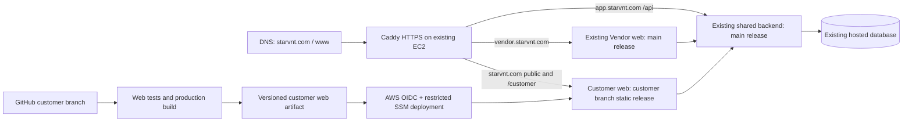

# STARVNT customer website and AWS rollout proposal

**Review draft — 3 November 2026. No website, DNS, CI/CD, or production server change has been made for this proposal.**

## Direction

STARVNT should present itself as a premium event experience brand. The first conversion is a qualified customer event enquiry; the second is a partner application. The public website should show real experiences and explain how discovery, planning, quotes, bookings, and event execution connect. Aura+ supports that journey without becoming the entire brand proposition.

The 12-page current-site PDF informs the cinematic imagery, dark visual tone, and event-category storytelling. It is a visual reference, not a source of verified market leadership, testimonials, financing, or service-coverage claims. The 134-page execution handbook calls for problem-specific landing pages, qualified-enquiry measurement, Kolkata-first proof, transparent scope, real vendor availability and reviews, and a customer journey from requirements through booking and payment tracking.

## Proposed sitemap

| URL | Audience and purpose | Primary action |
| --- | --- | --- |
| `/` | Premium brand home; event inspiration, how it works, real proof, customer and partner pathways | Plan your event |
| `/experiences` | Editorial overview of weddings, celebrations, corporate experiences, and entertainment | Start an enquiry |
| `/experiences/weddings`, `/celebrations`, `/corporate` | Category-specific stories and service discovery, only where the offering is supported | Tell us your requirements |
| `/how-it-works` | Requirements → curated options → written quotes → verified booking → execution | Start planning |
| `/stories` and `/stories/:slug` | Consent-cleared, genuine event projects or case studies; empty until approved content exists | Plan something similar |
| `/aura` | Explain Aura+ as an assistant for requirements, budget thinking and comparing options; label any preview capability | Try Aura+ |
| `/for-partners` | Partner value, eligibility, onboarding and real Vendor OS capabilities | Apply as a partner → `vendor.starvnt.com` |
| `/plan-event` | Short guest enquiry with event type, date/window, location, services, budget range, contact and consent | Submit enquiry |
| `/login`, `/signup` | Customer-only sign-in and registration on `starvnt.com` | Continue to `/customer` |
| `/customer/*` | Existing authenticated customer dashboard and event workspace on the same origin | Manage event |
| `/privacy`, `/terms` | Public legal pages | — |

`www.starvnt.com` should redirect to `starvnt.com`. The vendor portal stays at `vendor.starvnt.com`; `partner.starvnt.com` can retain its current alias behavior. City/locality SEO pages should be added only when coverage, useful original content and operations in those areas are confirmed.

## Desktop home wireframe

```text
┌───────────────────────────────────────────────────────────────────────┐
│ STARVNT  Experiences  How it works  Stories  For partners   Sign in  │
│                                               [Plan your event]       │
├───────────────────────────────────────────────────────────────────────┤
│ Cinematic, real event image/video                                     │
│                                                                       │
│ Your occasion deserves a remarkable experience.                      │
│ Curated professionals, clear choices, thoughtful execution.          │
│ [Plan your event]  [Explore experiences]                               │
│ Event type · Date/window · City                    [Get started]        │
├───────────────────────────────────────────────────────────────────────┤
│ Wedding | Celebrations | Corporate | Entertainment                   │
│ Large editorial cards with genuine imagery and concise service scope │
├───────────────────────────────────────────────────────────────────────┤
│ One considered journey: Share vision → Review options/quotes → Book  │
│ with verified payment → Track preparation and event day              │
├───────────────────────────────────────────────────────────────────────┤
│ Real event stories / vendor work (published only with rights/consent) │
├───────────────────────────────────────────────────────────────────────┤
│ Aura+ assistance: explore ideas and organise requirements            │
│ [Try Aura+]                         Human guidance remains available  │
├───────────────────────────────────────────────────────────────────────┤
│ For event professionals: show your work, respond to qualified leads, │
│ quote and manage bookings                       [Become a partner]    │
├───────────────────────────────────────────────────────────────────────┤
│ FAQ · Contact · Privacy · Terms · Customer sign in · Partner portal   │
└───────────────────────────────────────────────────────────────────────┘
```

## Mobile home wireframe

```text
┌──────────────────────────────┐
│ STARVNT          Sign in  ☰   │
├──────────────────────────────┤
│ Full-width event photograph  │
│ A remarkable event starts    │
│ with the right people.       │
│ [Plan your event]            │
│ [Explore experiences]        │
├──────────────────────────────┤
│ Wedding  Celebrations        │
│ Corporate  Entertainment     │
├──────────────────────────────┤
│ How it works (four short     │
│ steps, vertically stacked)   │
├──────────────────────────────┤
│ Real stories → Aura+ →       │
│ Partner invitation → Footer  │
└──────────────────────────────┘
```

The customer dashboard keeps its existing routes and utility-focused interface. The public site has a more editorial visual language: restrained deep navy, warm ivory, a controlled gold accent, premium photography, readable serif display headings and compact modern UI text. The existing STARVNT logo remains the anchor. Animation should be subtle, respect reduced-motion preferences and never delay the enquiry action.

## Customer lead journey

1. A visitor chooses an experience or taps **Plan your event**.
2. `/plan-event` captures only enough to qualify the request: event type, date or date range, city/locality, needed services, approximate budget, contact method and consent. Each step shows what happens next.
3. The server validates, rate-limits and deduplicates the request, records campaign attribution with consent, and sends it to an owned Core/Admin enquiry queue. A confirmation page shows the enquiry reference without claiming a vendor is available or booked.
4. A customer may create/sign in to an account to continue planning in `/customer`. The enquiry is linked only after identity verification, never by a guessed email or phone match.
5. The existing Customer OS handles detailed requirements, Aura+, service discovery, quotes, booking, payment status and event updates. Only server-verified payment may confirm a booking.

The lead form and associated backend queue are proposed additions; the existing customer branch already has the authenticated dashboard and Aura+ planning path, but the public guest-lead flow must be verified before advertising it as live.

## Technical architecture on the existing EC2



Live HTTP headers show Caddy on `vendor.starvnt.com`, while the repository's older `deploy/aws/nginx` files describe a different deployment layout. Inspect the running EC2/Caddy configuration before writing its route. Keep the customer static files in a separate versioned directory with an atomic `current` pointer, independent of the vendor bundle and backend container/process. The customer branch deployment must not run the `main` script that builds/restarts the backend and vendor.

Production frontend configuration should point to the existing `https://app.starvnt.com` API and set customer/vendor portal URLs consistently in web and backend. Verify CORS, cookie/token behavior, Google OAuth origins/redirects, MSG91 origins and CSP against `https://starvnt.com` before cutover. No secrets belong in the Vite bundle. The existing database remains hosted where it is; no database move is proposed.

The public marketing routes need crawlable page-specific HTML, titles, descriptions, canonical URLs, social previews and structured data only where factually supported. Use build-time prerendering for approved static experience pages and stories, with the existing React SPA continuing to own `/login`, `/signup` and `/customer/*`. This avoids adding another always-on server process to the EC2. Optimize real media for mobile, keep the main enquiry action keyboard-accessible, and measure Core Web Vitals after release.

## Customer-only CI/CD and safe cutover

1. On each push to `customer`, run customer web tests, static/type checks where available, and a production build; deploy only after checks pass. Use a `customer`-scoped OIDC role and SSM command with artifact checksum and revision metadata. No persistent SSH key is needed.
2. On EC2, unpack to `/srv/starvnt/customer/releases/<commit-sha>`, smoke-test the candidate through the intended virtual host, then atomically switch the customer `current` pointer. Retain previous releases for rollback.
3. Check EC2 memory, CPU and disk headroom before adding the new static site. Static files should add little runtime memory, but the check must use live metrics.
4. Prepare Caddy virtual hosts and a valid TLS certificate for apex and `www` while preserving the existing vendor/API routes. Test with a host override before DNS cutover.
5. Back up the DNS zone and shorten the apex/`www` TTL. The current apex resolves to a LiteSpeed host (`103.49.70.24`), while the vendor/API host resolves to AWS (`35.154.67.51`); `www` currently resolves through Vercel. Change only apex/`www` web records after the AWS site passes smoke tests. Preserve mail MX/TXT and all existing vendor/API records.
6. Verify public home, all CTAs, guest enquiry, sign-in/signup, `/customer` direct load and refresh, API/auth, legal pages, mobile layout, analytics attribution, TLS and redirects. Roll back DNS or the customer release pointer if any critical path fails. Retire the Vercel project only after stable operation and review of its remaining domain/configuration dependencies.

## Content and measurement gates

- Never publish the sample PDF's unsupported “India's #1”, invented social proof, fixed EMI promises, unverified wide-area coverage, or a launch date already in the past. Moniqui/FTAURA sections appear only if those services, content rights and fulfilment paths are approved.
- Use real portfolio media with rights/consent; display reviews only when tied to eligible genuine transactions. Label sponsored vendor placements if introduced.
- Measure visitor → enquiry start → qualified enquiry → shortlist/quote → booking → verified payment, plus partner application → approved/active partner. A visit or registration alone is not a successful lead.
- Initial editorial emphasis: Kolkata and nearby supported markets; expand geography only with verified operating coverage.

## Review decisions before implementation

The recommended public positioning is **“Premium event experiences, thoughtfully planned and confidently booked.”** Customer enquiry is the primary CTA. Partner recruitment is prominent in the navigation and a dedicated mid-page section, while the partner dashboard remains on `vendor.starvnt.com`. Confirm the wording and priority of the first experience category before design implementation; weddings are the proposed first hero category, with corporate and celebrations directly accessible.
