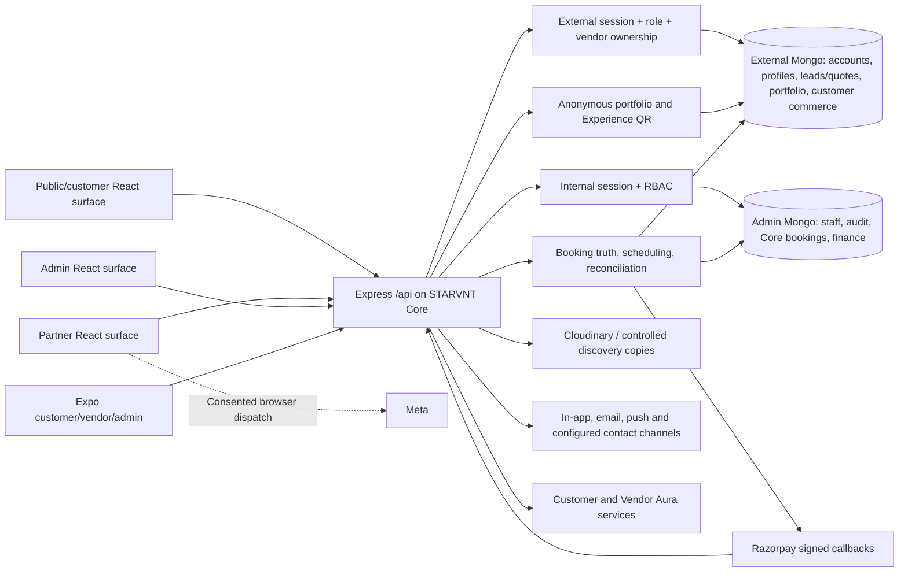

# STARVNT Phase 1 Vendor Growth & Marketing

**Founder review package · 7 November 2026 · Original audit baseline**

**Review decision.** Approve the architecture, scope and release gates below and authorize the Foundation slice. Approve routing, commercial policy, content rights, provider changes and production rollout through their individual gates. Estimates and policies in this package are proposals.

**Implementation follow-up.** The subsequent go-ahead covered local implementation for both this blueprint and the governance handbook. The first changes enforce public portfolio filtering, add owner-managed social links and opt-in profile sharing, prepare public partnership and sample demo routes, and integrate configured signup documents with versioned acceptance. The original audit below records its baseline. See the [implementation handoff](vendor-growth-and-governance-implementation.md) for current status and remaining gates.

**First release blocker.** An anonymous request returned synthetic private and unlisted portfolio asset URLs on the audited branch. Resolve the public media authorization and direct-URL exposure before enabling Share Center, share QR or new public profile routes. Deployed exposure remains unverified.

Vendor Growth and non-ticketing governance belong to Phase 1. Blueprint §§30 and 32 describe the order of work inside Phase 1. Phase 2 covers event ticket sales and booking, ticket QR generation and scanning, ticket orders and payments, ticket refunds and settlements, and ticketing-specific workflows and modules. The Phase 2 rollout also covers vendor profile QR and Experience QR feedback. The Phase 1 rollout retains regular profile links and the existing non-ticketing booking and payment workflows.

**Requirements source.** STARVNT Unified Vendor Growth & Marketing Ecosystem Master Blueprint, Founder Review Edition, 18 pages, §§0–34 and appendices A–D. The accompanying developer prompt controls scope and authorization. Paths below are relative to this report or explicitly qualified as application routes.

## 1. Existing system audit

Audited local `customer-dev` at `de1ffcb`. The local tracking ref for `origin/customer-dev` was one commit ahead and one behind HEAD, with remote-only `b58996c` by that ref. The baseline includes existing tracked edits and untracked work for partner acquisition/Meta, portal access, Discovery Rewards, customer profile photos, deployment and reviews. Preserve and reconcile these changes with their owners before implementation, especially where they touch auth, activation, portal routing or workers.

| Area | UI → API → authorization → data and integrations | Audit finding |
| --- | --- | --- |
| Portal surfaces | [Application routes](../web/src/App.jsx) and [portal access helpers](../web/src/lib/portalAccess.js) use a customer/vendor build setting. [Login](../web/src/pages/external/Login.jsx) accepts a return path constrained to the active portal. [External auth routes](../server/src/external/routes/auth.routes.js) create accounts and sessions for password, Google and phone OTP paths. [External middleware](../server/src/external/middleware/requireExternalAuth.js) checks the token audience, active account, session and surface. | Vendor-build root redirects through Partner OS to auth. Customer build has no Partnership/demo routes. Existing safe return handling is portal-local and needs a narrow cross-origin handoff. |
| Partner onboarding | [Vendor Portal](../web/src/pages/vendor/VendorPortal.jsx) and [Readiness](../web/src/pages/vendor/pages/ReadinessPage.jsx) use the owner-scoped [vendor API](../server/src/external/routes/vendor.routes.js) for profile, services, locations, portfolio, documents, financial truth and activation. [Activation evaluator](../server/src/external/services/vendorActivation.service.js) combines contact, business, operating and review evidence. [Admin review](../server/src/admin/services/vendorActivationReview.js) records decisions. [Matching](../server/src/external/services/matching.service.js) applies readiness to individual services. | Reuse the evaluator and saved progress. Contract acceptance, subscription and payment need independent state. Any new restriction needs policy, reason codes and a migration for existing vendors. |
| Public identity and media | [Customer service detail](../server/src/customer/services/events.service.js) projects vendor/profile data and queries public published portfolio. [Portfolio routes](../server/src/external/routes/portfolio.routes.js) use vendor owner context for writes, Cloudinary for uploads and [PortfolioItem](../server/src/external/models/PortfolioItem.js) for URL, status and visibility. Customer discovery uses sanitized review copies and permission checks in [Discovery Rewards](../server/src/experience/discoveryRewards.routes.js). | **Release blocker.** Anonymous `GET /api/vendors/:vendorId/portfolio` passes publication status into [queryVendorPortfolio](../server/src/external/services/portfolio.service.js#L192), which omits visibility from its filter. It serializes asset URLs via the route DTO. The customer catalogue's visibility filter covers a different path. Standard portfolio uploads also return directly deliverable provider URLs. A server-side view filter alone cannot revoke a previously distributed URL. Inventory all media paths before enabling sharing or rights-managed playback. |
| Business and leads | [Vendor Enquiries](../web/src/pages/vendor/pages/Enquiries.jsx) uses [transaction routes](../server/src/external/routes/transaction.routes.js) to manage opportunities anchored to account, event and vendor ownership. [Commercial routes](../server/src/external/routes/commercial.routes.js) reuse matching, availability and costing. [Proposal service](../server/src/proposals/service.js) gates event proposal versions on per-line approvals and frozen snapshots. [External booking operations](../server/src/external/services/externalBookingOperations.js) keep off-platform contracts and receipts scoped to the owner. | Preserve the working enquiry pipeline. The Admin RBAC catalogue lists `leads.*`, but the reviewed Admin mounts and shell did not establish a dedicated staff lead assignment workflow. Confirm the deployed surface and canonical lead states with Ops before regression sign-off. Quote acceptance opens a reservation. Use `CoreBooking` confirmation for conversion and distinguish vendor-entered payments from platform-verified payments. An event proposal line approval is separate from a master partnership agreement. |
| Payments, cart and settlement | Customer [commerce](../server/src/customer/services/commerce.service.js), [booking reconciliation](../server/src/customer/services/bookingTruth.service.js), [CoreBooking](../server/src/admin/models/CoreBooking.js) and [Finance ledger](../server/src/admin/services/financeLedger.service.js) form the service cart/booking/finance chain. [Razorpay adapter](../server/src/customer/services/payments/razorpay.js) creates/fetches orders and verifies signatures. [App mounts](../server/src/app.js) place the raw webhook before JSON. [Webhook repository](../server/src/customer/repositories/commerce.repo.js) has an event ID, processing lease and failed-delivery retry. [Admin policy routes](../server/src/admin/routes/policy.routes.js) version and independently approve financial policy. | Reuse transport, signature validation, receipt and reconciliation patterns. The existing webhook resolves customer payment orders and ignores unknown orders. A vendor subscription needs explicit payment-purpose routing before an event can be completed. No vendor subscription entitlement, plan history, mandate or activation contract found in reviewed source. Payment authorization, capture, verified entitlement and settlement remain separate. |
| Dashboard, reviews and analytics | [Dashboard](../web/src/pages/vendor/pages/DashboardHome.jsx) reads the [dashboard service](../server/src/external/services/vendorDashboard.service.js), which draws from owned operations and financial truth. [Reviews UI](../web/src/pages/vendor/pages/InsightPages.jsx) separates verified STARVNT and Google ratings. [First response](../server/src/external/services/vendorFirstResponseMetrics.service.js), Discovery interactions/conversions and [Experience feedback](../server/src/experience/feedback.service.js) provide distinct evidence. | Reuse data for existing work queues. Add bounded growth cards with their own errors/empty states. Remove fallback five-star rendering for missing individual review ratings as part of dashboard acceptance. A provider rating with zero/missing reviews and pending or suppressed feedback cannot substitute for a verified rating. |
| Consent, acceptance and Experience QR | [Foundation consent](../server/src/foundation/consent.service.js) records customer purpose, scope, channel and decision history. [Experience routes](../server/src/experience/routes.js) separately handle expiring recipient QR feedback, moderation, opt-ins and withdrawal. Vendor readiness has a [growth preference](../server/src/external/routes/readiness.routes.js). [Public legal pages](../web/src/pages/PublicPolicyPage.jsx) use publication placeholders. The [local legal review](legal-privacy-release-review-2026-11-07.md) records acceptance gaps. | These mechanisms cannot stand in for vendor asset grants, customer/model releases or agreement acceptance. No approved master partnership acceptance contract was found in the reviewed worktree. Confirm separate engine status and terms with its owner. Preserve Experience QR semantics and scope. |
| Vendor acquisition and Meta | Working changes [PartnerMarketing](../web/src/components/PartnerMarketing.jsx), [Meta helper](../web/src/lib/metaPixel.js) and [acquisition journal](../server/src/external/services/vendorAcquisition.service.js) implement consent-gated image dispatch, sanitized browser events, opaque IDs and an owner-scoped atomic claim. Existing vendors baseline without replay. [Integration notes](meta-pixel-partner.md) describe host-local consent and attribution and at-most-once browser dispatch. | Reuse operational milestones. Current application event is `SubmitApplication`, with consent/device and lost-claim limitations. Add approved mapping and a verified payment source. Server consent, delivery outbox and CAPI are pending design/account approval. Claim success is insufficient evidence of Meta ingestion. |
| Growth and notifications | [Launchpad](../server/src/experience/launchpad.service.js) derives milestones. [Discovery Rewards models](../server/src/experience/discoveryRewards.models.js) already support versioned XP rules, achievements, challenges and benefit/redemption evidence. [Customer Growth](../web/src/pages/vendor/pages/CustomerGrowth.jsx) uses [growth service](../server/src/experience/growth.service.js) for vendor-owned permissioned in-app campaigns. [Notification service](../server/src/notifications/notification.service.js), [preferences](../server/src/notifications/preferences.routes.js), [push](../server/src/notifications/push.service.js) and [workers](../server/src/workers/coreWorkers.js) provide delivery patterns. | Reuse evidence, preferences and workers. Vendor customer campaigns have a distinct audience, purpose and owner from company campaigns. No Academy, per-vendor viewing progress, managed meeting attendance/recordings, story review or company campaign spend workflow found. Verify channel-specific vendor opt-out behavior before extending promotions. |
| Staff and Aura+ | [Admin Shell](../web/src/pages/admin/AdminShell.jsx) has reports, reviews/experience and Discovery Rewards. [Admin auth](../server/src/admin/middleware/requireAdminAuth.js), [permission catalogue](../server/src/admin/constants/permissions.js) and [audit writer](../server/src/admin/utils/audit.js) provide internal identity, checks and audit history. [Vendor Aura routes](../server/src/external/routes/vendorAura.routes.js), [context](../server/src/external/aura/vendorContext.js) and [setup actions](../server/src/external/aura/setupActions.js) support owned context and existing actions. | Separate Vendor Growth and company Marketing permissions. Do not map existing `growth.manage` to spend, marketing publishing or rights approval. Add read-scoped Aura context and action allowlists. Preserve existing authorized setup behavior. |
| Mobile and deployment | [Expo navigation](../mobile/src/App.tsx), [vendor dashboard](../mobile/src/screens/VendorBusiness.tsx), [profile](../mobile/src/screens/VendorProfile.tsx), [portfolio](../mobile/src/screens/VendorPortfolio.tsx) and [Experience](../mobile/src/screens/ExperiencePage.tsx) cover existing journeys. [Main AWS workflow](../.github/workflows/deploy-aws.yml), [customer AWS workflow](../.github/workflows/deploy-customer-aws.yml), [Nginx](../deploy/aws/nginx/starvnt.conf), [runbook](../deploy/aws/AWS_DEPLOYMENT_RUNBOOK.md) and [Kubernetes manifests](../k8s) describe several deployment paths. | Expo coverage is partial for this workstream. Customer workflow targets `customer`, main workflow targets `main`, and partner/vendor host assumptions vary by config. Resolve which artifact serves each hostname, SPA rewrites, CORS, auth and tracking ownership before adding routes. Configuration does not identify what is live. |

### Current architecture

Source anchors are [Express mounts](../server/src/app.js), [database connections](../server/src/db/index.js) and [startup and workers](../server/src/index.js). Proposed capabilities stay inside these portals, Core and the existing Mongo connections. Domain services should share policy, media and finance adapters while retaining independent ownership and state.

## 2. Blueprint requirements and reuse matrix

**Proposed accountable roles.** Eng = Yogesh/engineering, UX = product design, Ops = vendor operations, Content = Founder/content, Mkt = company marketing, Fin = Finance/CA, Legal = legal/privacy, QA = release verification. Confirm assignments in review.

| PDF section | Existing evidence / gap | Proposed change and owner | Dependency / acceptance |
| --- | --- | --- | --- |
| Cover, governance, §0 pp. 1–3 | [Portal routes](../web/src/App.jsx) and [Core mounts](../server/src/app.js) give shared infrastructure. Growth lifecycle spans disconnected surfaces. | Eng/Product sequence the whole lifecycle in Phase 1 and separate company marketing from vendor sharing. | Founder gate. Trace guest → verified vendor → business → share → learn → recognition. |
| §1 p. 3 | [Landing and route shell](../web/src/App.jsx), no public partnership route. | UX/Eng build mobile-first Partnership page in the public build. | Approved hostname, copy, offer and privacy. Anonymous entry and both CTAs work across hosts. |
| §§2–3 pp. 3–4 | [Cloudinary upload](../server/src/external/routes/portfolio.routes.js) exists. Founder and Academy publishing are missing. | Content produces authentic Founder segments and agreed tutorial cut list. Eng reuses approved media delivery. | Approved claims, captions, poster, 1080p source and deliberate 16:9/9:16 edits. Playback and controls pass on phone and desktop. |
| §4 p. 4 | [Customer demo tooling](../server/src/external/routes/transaction.routes.js) is tied to customer activity. | UX/Eng build an interactive fixture-only demo bundle. | Cover all thirteen modules. Sample label on each view. Network test shows zero operational requests or writes. |
| §§5–6 pp. 4–5 | [Activation](../server/src/external/services/vendorActivation.service.js), [dashboard](../server/src/external/services/vendorDashboard.service.js), no agreement/entitlement truth or learning cards. | Eng keeps independently computed states and adds actionable growth cards. | Agreement Engine and commercial policy. Legacy vendors resume. Verification and matching lock reasons remain explicit. Zero reviews shows empty state. |
| §7 p. 5 | [Transactions](../server/src/external/routes/transaction.routes.js), [vendor services](../server/src/external/routes/vendor.routes.js), [finance](../server/src/admin/services/financeLedger.service.js). | Eng reuse services, availability and quotes. Project verified business facts and protect financial data. | Preserve quote snapshot, service-cart flow, event proposals, lead assignment, Core confirmation and distinct settlement. |
| §8 pp. 5–6 | [Canonical organization](../server/src/external/models/VendorOrganization.js) lacks extensible social links. | Eng adds bounded typed links and a public DTO field. | Allowlisted exact destinations and platform names/icons. Hidden/removed/invalid absent. No false verification. |
| §§9–10 pp. 6–7 | [Experience QR](../server/src/experience/routes.js) and QR library can inform UI/rendering. | Eng/UX build distinct Share Center and branded templates for eligible resources. | Media gate and public URLs. Preview, explicit actions, safe copy/native/QR/authorized artwork. Vendor identity prominent. |
| §11 p. 7 | [Discovery conversions](../server/src/experience/discoveryRewards.models.js) and vendor metrics cover adjacent events. | Product/Eng add typed share and referral evidence with first-party attribution. | Accepted qualification/window. Unique downstream source IDs. Cross-vendor attempts denied. |
| §12 pp. 7–8 | [Portfolio](../server/src/external/models/PortfolioItem.js), [consent](../server/src/foundation/consent.service.js) and discovery revocation patterns. | Eng/Legal implement rights per use, evidence, expiry, revocation and follow-up. | Approved grants and controlled media access. All links, QR and download routes fail closed after revocation. |
| §13 p. 8 | [Portfolio upload](../server/src/external/routes/portfolio.routes.js) is vendor-owned, no Academy catalogue or playback state. | Eng/Content publish eight blueprint categories, captioned videos, recommendations, resources and saved progress. | Restricted delivery and approved lesson assets. Cross-device resume and staff preview/publish tests. |
| §14 p. 9 | [Notification workers](../server/src/workers/coreWorkers.js) support scheduling patterns. No growth-meeting records. | Ops/Eng add staff-managed Meet series, 12-topic rotation, RSVP, attendance, summaries, resources and feedback. | Meet access and recording policy. Reschedule/cancel suppresses old reminders, attendee data stays private. |
| §15 p. 9 | [Growth UI](../web/src/pages/vendor/pages/CustomerGrowth.jsx) is customer engagement, no editorial story workflow. | Ops/Content track documented consent and vendor approval of each final revision, correction and removal. | Rights templates. Unapproved revisions cannot publish. Self-reported numbers labeled. |
| §16 pp. 9–10 | [Rewards](../server/src/experience/discoveryRewards.models.js) has XP and challenges. No distinct verified award scoring/appeals. | Ops/Eng extend evidence and use versioned award decisions with appeal history. | Founder approves weights, minimum evidence and appeal rules. Same scoring evidence for free and paid vendors. |
| §17 p. 10 | Existing [benefit/redemption](../server/src/experience/discoveryRewards.models.js) can inform workflow. Travel-specific record and policy unresolved. | Founder/Fin/Ops retain Family Experience in programme backlog. Extend records only after launch decision. | Budget, eligibility, logistics, insurance, tax and terms. No family data before selection and consent. |
| §18 p. 10 | [Partner navigation](../web/src/pages/vendor/VendorPortal.jsx) has Launchpad and Discovery Rewards. | UX/Eng add Learning & Growth and link existing evidence where appropriate. | Mobile route coverage. Growth cards stay secondary to work queues. |
| §19 p. 10 | [Vendor Aura](../server/src/external/aura/vendorAura.service.js) has contextual prompts/actions. | Eng adds owned learning/share/subscription read context and suggestions. | Facts cite backend evidence. Separate approved actions and role tests. |
| §§20–21 pp. 10–11 | [Razorpay and booking commerce](../server/src/customer/services/commerce.service.js) reusable. Subscription truth absent. | Eng/Fin introduce versioned offers, immutable grants and purchase reconciliation. | Pricing, eligibility, timezone, GST, refund policy and provider test access. Month-end expiry and zero automatic conversion. |
| §22 p. 11 | [Vendor Acquisition](../server/src/external/services/vendorAcquisition.service.js) and [Pixel](../web/src/lib/metaPixel.js). | Eng/Privacy map accepted application, paid/free and verified payment facts to approved events. | Meta ownership, consent and Test Events. Shared event ID. Free grant creates zero Purchase. |
| §23 p. 11 | [Preferences](../server/src/notifications/preferences.routes.js), [delivery](../server/src/notifications/notification.service.js) and [push](../server/src/notifications/push.service.js). | Eng/Ops add purpose-specific templates and evidence. Reuse retries and opt-outs. | Channels, quiet hours and recipients approved. Withdrawal at dispatch and dedupe across retries. |
| §24 p. 12 | [Admin Shell](../web/src/pages/admin/AdminShell.jsx), [RBAC](../server/src/admin/constants/permissions.js) and [audits](../server/src/admin/utils/audit.js). | Eng/Ops build Vendor Growth & Community. Eng/Mkt/Fin build company workspace with explicit publish/spend separation. | Role grants, budgets, rights and invoices. Draft → approve → publish/pause → reconcile evidenced. |
| §§25–26 p. 13 | [Reporting](../server/src/admin/routes/reports.routes.js) and Aura reuse candidates, no approved marketing cost planner or staff context. | Mkt/Fin compare organic, capped test and scale cases. Eng adds staff read-only Aura context. | Approved experiment cap/stop criteria. Evidence, cash, effort and ranges visible. No AI publication or spend. |
| §27 p. 13 | [Dual Mongo](../server/src/db/index.js) plus business records. | Eng proposes additive schema and scoped APIs below. | Index and migration rehearsal with historical fixtures. Existing truth stays authoritative. |
| §28 pp. 13–14 | [External auth](../server/src/external/middleware/requireExternalAuth.js), [internal auth](../server/src/admin/middleware/requireAdminAuth.js), portfolio gap above. | Eng/Legal enforce access and data retention per use, with independent rights and recognition. | Negative tests for role, tenant, direct assets, data removal and revoked permissions. |
| §29 p. 14 | [Dashboard metrics](vendor-dashboard-metric-definitions.md), Discovery and acquisition evidence. | Product/Eng adopt event taxonomy and auditable denominators below. | Approve sources, attribution windows, consent and retention. Unknown and unattributed remain visible. |
| §30 pp. 14–15 | [Existing QA baseline](vendor-os-acceptance-audit-2026-10-27.md) and two deployment lanes. | Eng/QA deliver five Phase 1 slices after sign-off. | Slice regression/evidence matrix below, followed by staging acceptance and production approval. |
| §31 p. 15 | Existing tests cover portions of auth, commerce, media, analytics and privacy. | QA traces every acceptance outcome to a test and environment in the sign-off packet. | Require user journeys and negative cases for rights, payments, permissions, AI and existing features. |
| §32 pp. 15–16 | Existing Core workflows and rights gaps establish implementation priorities. | Product prioritizes Foundation and sharing, then runs independent content/community work and gated marketing. | Family Experience requires separate approval. Each slice has cost, dependency and acceptance evidence. |
| §§33–34 pp. 16–17 | Current tools cover much of vendor operations. Founder brief and approval record remain dependencies. | Founder reviews this package and authorizes the first slice. Product keeps a decision register. | Approved revision, scope, owners and release checkpoints recorded. |
| Appendices A–D pp. 17–18 | Draft Founder script, positioning and commercial/rights guardrails. | Content verifies all personal claims. Product translates positioning into UX. Legal/Fin/Ops close the listed gates. | Written decisions and negative tests for guaranteed claims, paid conversion, private exposure, duplicate truth and unauthorized launch. |

## 3. Proposed API, data and migration plan

Routes and model names below are proposed contracts. Build domain modules inside the existing Express process and use the existing Core workers. Use the external database for vendor/customer-owned records and the admin database for company-only records. Cross-database links use stable IDs and reconciliation. Validate deployment topology before relying on Mongo transactions across records. Use atomic conditional writes on revisions, scoped idempotency keys and recoverable outbox or receipt records where updates span domains. APIs return stable reason codes, permitted next actions and sanitized DTOs. Use pagination for histories and consistent 400/401/403/404/409 responses. Public access denial should avoid disclosing a restricted resource's existence.

| Domain and proposed API | Reuse, additions and why the current records are insufficient | Existing records and rollback |
| --- | --- | --- |
| Readiness and agreement · extend vendor profile/readiness DTO, read the current approved agreement and submit acceptance through the agreement engine | Extend existing derived states for contact, profile, business verification, activation and service-level eligibility. Reference the master agreement version, hash, actor and acceptance ID from the approved engine. Signup terms, master partnership terms, event proposal approval and booking-specific authorizations remain distinct. | Keep saved progress, existing activation and scopes. Use the approved reacceptance/grace rule for existing vendors. Never infer a signature from registration or proposal history. Gate enforcement by surface and effective version. Roll back enforcement flag while retaining acceptance and audit history. |
| Social identity · `GET/PUT /api/vendor/profile/social-links`, existing public profile projection | Add typed bounded links to `VendorOrganization` with platform, exact validated URL, state and revision. Central registry of domains and profile paths in code is sufficient initially. Canonical profile update needs owner identity and optimistic revision. Staff may suspend display with reason, with vendor URL and audit preserved. | Empty list on legacy profiles. Carry only explicit, valid, confirmed links when a trusted legacy source exists. Disable editor and projection without deleting vendor data. |
| Public resource and share · profile projection, `/api/vendor/share-links`, `/s/:token`, `/api/vendor/share-links/:id/artwork` | Reuse public vendor/service/portfolio records. Add an opaque `ShareLink` with unique token hash and resource/vendor/type reference because existing URLs cannot represent a controlled origin, expiration or QR variant. Share page renders sanitized previews and reauthorizes the target on every resolution. Add stable project IDs only where the current project-name grouping cannot identify immutable share targets. Profile/service first. Packages, offers and enquiry pages appear only when a canonical eligible public target exists. | Existing public customer browse paths remain. Disable creation and use a controlled public tombstone for issued links on rollback. Keep evidence and never redirect to a raw provider URL. |
| Media rights · per-asset grant/revoke, usage lookup and restricted delivery/download | Reference canonical portfolio/provider IDs and reuse verified discovery delivery patterns. Add `AssetRightsDecision` because a mutable visibility setting and customer channel consent lack purpose-specific, per-asset evidence. Keep effective grant pointer/revision, third-party rights evidence, source/owner, permitted use/channel, effective/expiry times and immutable history. Track usage through explicit references on publications and campaign placements. Use existing audit and a durable operations task/outbox for removal, with unique asset/revocation/placement key. | Unknown rights mean ineligible for new share/download/company use. Inventory URL exposure before converting legacy media. For restricted assets replace direct public delivery with authorized proxy or short-lived provider access, rotate/purge legacy URLs where supported and verify CDN, thumbnail and original paths. Roll back by disabling new uses and serving unavailable for restricted assets. Preserve privacy controls. |
| Academy and editorial · `/api/vendor/learning`, lesson access/progress/resource actions and `/api/admin/vendor-growth/content` | Add `GrowthContent` for versioned lessons, resources, announcements and story revisions with typed validation, publication/schedule, audience, caption tracks and rights references. Portfolio has neither audience nor editorial revision semantics. Add `LearningProgress` unique on vendor and lesson, with revision-aware completion and resume checkpoint, as these records are vendor-specific. Story consent/final vendor approval bind the published revision and actor. Reuse Cloudinary and workers. | Start with published approved assets only and no inferred progress. Compatible content edits preserve progress by policy. Materially changed lessons use a new completion revision. Hide access/navigation and pause jobs on rollback. Keep progress and history. |
| Meetings · vendor list/detail/RSVP/join/feedback and admin scheduling, attendance and recording publish | Add `GrowthMeeting` plus `MeetingParticipation` unique on session and vendor for RSVP, actual attendance source, recording notice/consent and feedback. Customer events and availability appointments lack audience, attendance and editorial workflows. Keep staff-created Google Meet URL off list DTOs and restrict join at runtime. Reuse notification preferences/workers. | Start empty. Save UTC plus IANA timezone and schedule revision. Update/cancel invalidates queued reminders and join windows. Keep recordings unpublished until consent and provider permissions verify. Disable feature/jobs and retain records on rollback. |
| Awards and appeals · vendor achievements/eligibility and admin rules/evidence/decisions/appeal | Reuse `VendorAchievement` and source records for display/evidence. Extend existing versioned reward rule mechanisms where contracts allow. Add typed `RecognitionDecision` only for nomination, immutable evidence/score version, independent approval and appeals, which XP/redemption do not represent. Family data/program additions are conditional on approval. Reuse benefit and audit workflow where possible, with restricted enrolment and expenses only if needed. | Keep XP and existing benefit history. Never re-score approved historical awards in place. On rollback pause new decisions and preserve appeals, evidence and audit. |
| Subscription · vendor plan/status/free grant/order/reconcile/cancel and staff plan/offer/exception reads | Add versioned `VendorPlanOffer` and `VendorEntitlement` because no versioned vendor offer/grant exists and customer reservations cannot represent a vendor grant. Reuse payment primitives with typed purpose, order intent, money in integer paise and verified provider reference. Use existing payment collection only if ownership and required fields support a vendor purpose safely. If a cart-bound schema requires customer/event context, add a minimal `VendorSubscriptionPayment` with unique order/payment IDs instead of synthetic customer events. Route signed Razorpay deliveries by trusted persisted order ID before normal reconciliation. Use finance ledger adapter with typed purpose/source or a scoped finance mapping where the existing booking schema is required. | Existing vendor remains eligible under current business rules until policy says otherwise. Default entitlement unknown/unassigned. No retroactive charge or fabricated grant. Offer version and UTC expiry are frozen at activation. Flag off new orders/free grants during rollback while keeping webhook receipt, reconciliation, cancellation, refund and existing entitlements operational. |
| Company marketing · `/api/admin/marketing` campaigns, approvals, placements, expenses and reports | Add `MarketingCampaign` and `MarketingPlacement` for company owner, lifecycle, schedule/content calendar and revisioned creative rights. Add `MarketingSpendEntry` for append-only commitment/actual/adjustment records with invoice/reference and unique import key. Approval is revision-bound with scoped identity and audit. Company budgets require atomic cap reservations. Vendor `GrowthCampaign` lacks company roles and financial approvals, and booking ledger handles a different financial domain. Library uses canonical brand/provider references plus rights, not copies of vendor business ownership. | Seed permissions without grant. Existing vendor campaigns remain separate. Roll back publishing and commitments first, keep pause and spend reconciliation available. Keep campaign and finance history. |
| Analytics and Meta · scoped vendor/staff analytics, public visit resolver and provider dispatch | Reuse `VendorAcquisition`, Discovery and Core source evidence. Add bounded `GrowthEvent` with event-specific fields and unique event key only for observations unavailable in existing sources. Link attributed conversions via unique canonical source key and immutable attribution decision. Add a provider delivery receipt/outbox only when reliable CAPI is approved, since existing browser claims have no durable provider retry acknowledgement. | No inferred historical share visits, consent or conversions. Use null/unknown where coverage is incomplete. Disable observation/dispatch independently. Retain required audit/finance records and respect approved analytics retention/deletion. |

**Migration runbook.** First inspect document counts, indexes, unique-key collisions, status/visibility distribution, raw media references, permissions, legacy vendor readiness and provider linkage using an approved read-only snapshot. Rehearse against de-identified staging data. Create additive indexes with preflight conflict reports, deploy readers tolerant of missing fields, run resumable batched dry-run then approved write backfills, verify counts/checksums, and enable isolated flags per slice. Record checkpoint and per-record provenance. Keep older readers compatible where possible. Do not drop old fields, overwrite accepted snapshots, or reverse money movements through a schema rollback. Take a verified backup before production work, with restore rehearsal and incident owner. Rollback order is disable affected entry points, keep payment/rights controls online, stop queued side effects, then revert the release artifact where safe.

**Commercial transitions proposed for approval.** Compute a free grant once as the earlier of six calendar months from activation in the configured business timezone and offer end at local end-of-day. Use an exclusive instant at the next local midnight for the offer cap, define month-end clamping and test leap days. Persist source plan/offer version and exact UTC expiry. Free → expired sends reminders and updates access per approved policy. Paid checkout needs an affirmative vendor choice against immutable plan/amount/currency/terms. A recurring mandate, if later authorized, has separate disclosure, consent, provider mandate state and cancellation. A late or duplicate payment only applies once and never creates a second entitlement. Verified capture for the exact amount, currency and owned order is required. Failed/expired order remains separately visible and can be retried with a new attempt after checking for late capture. If a captured order arrives after entitlement eligibility changes, queue a finance exception instead of guessing whether to grant or refund. Reconcile signed refunds to payment and finance history and apply the approved full/partial refund and access policy. Reconcile order-create timeouts by provider receipt before creating another order. Hold ambiguous cases for Finance. Maintain an idempotent activation/ledger receipt and notify only after the verified transition.

## 4. Proposed desktop and mobile flows

Responsive web is required for all surfaces. Proposed native parity covers vendor operations, social editing, Share Center and Learning & Growth as slices ship, with public acquisition in the browser and staff control available on responsive Admin web. Product should approve native staff parity separately. Reuse [web theme](../web/src/theme.css) and generated native brand values for shared controls. For public partnership pages, map the blueprint's obsidian/deep navy, Aura blue and platinum to scoped theme tokens, with accessible text contrast and shared Inter typography. Keep status chips consistent and give each loading, empty, failure, access-denied and retry state a visible label.

| Screen | Desktop flow | Mobile flow and acceptance |
| --- | --- | --- |
| Public Partnership `/partners` | Section nav and hero with approved Founder poster, primary **Become a STARVNT Partner**, secondary **Explore Vendor OS**. Follow with vendor problem/solution, onboarding, tools, identity/sharing, Academy/community, stories/recognition, pricing, trust/terms, FAQ and repeated CTA. | Compact menu and stacked hero, captioned video opened by user, stable poster dimensions, portrait asset chosen by layout. Both CTAs remain keyboard/touch accessible. Publish only approved claims and price. |
| Public demo `/partners/demo` | Fixture-only shell with persistent **Interactive Product Demonstration — Sample Data** label. Tabs for Dashboard, Profile, Portfolio, Enquiries, Quotes, Bookings, Payments, Reviews, Analytics, Academy, Social Links, Share Center and Subscription. Allow sample filtering, quote preview and local interactions. | Group tabs in a labelled selector. Show sample states and reset. No authenticated data requests, upload, checkout, booking, publication or other write calls. Preserve return to overview/demo. |
| Public vendor profile and target | Canonical business heading, approved locations/services, public portfolio, verified reviews and social icons beside accessible labels. Share previews resolve from current public data and keep vendor identity prominent. | Stack cards and use link targets with safe new-tab handling. A restricted/expired target displays an unavailable state. No social display until the platform and exact saved URL validate. |
| Signup and contact verification | Partnership CTA sends allowlisted onboarding intent to the approved Partner host. Use existing registration and identity routes with approved terms shown before account creation where required. Return to saved progress after auth. | Correct keyboard inputs for OTP, resend countdown, back/retry and duplicate-account resolution. Native deep-link association optional only after staging validation. Do not send account credentials, provider identifiers or sensitive params in cross-origin redirects. |
| Vendor setup and agreement | Profile → category → location → portfolio → business documents/review → applicable master terms and offer. Derive each status from server. Show incomplete evidence and permitted next action. Preserve operational tools subject to existing policy. | Step list with save/resume, accessible errors, upload progress and retry. Terms acceptance binds current version and prevents stale acceptance. Optional consents are separate controls. |
| Vendor dashboard and business | Pending enquiries, quotes, bookings and payments above Growth Meeting, Continue Watching, Share Performance, Achievements and Subscription. Existing enquiry → quote/version → accepted reservation → Core-confirmed booking → verified payment/settlement journeys stay intact. | Prioritize a work queue with “see all,” scrollable secondary cards and responsive financial labels. No rating when verified review count is zero. Use existing calendar/availability and business nav. |
| Social Media Links | Profile & Hub editor, platform choice, URL validation preview, visibility switch, save/remove and safe opening. Show separate moderation state where applicable. | One link form at a time, URL keyboard, focus error message, explicit delete confirmation, saved state and recovery after stale edit. |
| Share Your Business | Marketing & Growth picker for eligible profiles, services, packages, projects/media/offers. Preview branding and exact destination, then Copy, Native Share, supported destinations, Share QR and authorized artwork. Analytics tab distinguishes intent, visits and conversions. | Native/OS share sheet if supported, copy fallback if dismissed or unavailable, QR download/scan preview and explicit per-channel action. Disabled actions explain unavailable rights without exposing private assets. |
| Academy and lesson player | Learning hub with search, eight categories, recent/recommended, completion history and Continue Watching. Lesson detail contains captioned player, objective/difficulty, progress, resources and feedback. | Responsive player, captions and transcript when available, accessible playback controls, resume after app/background or interrupted network. Restricted resources recheck at open/download. |
| Meetings, community and stories | Upcoming/past meeting list with time in vendor timezone, RSVP, join, summaries/resources and feedback. Community shows announcements and approved stories with report/correction controls. | Show timezone and changed/cancelled status. Join link only upon authorized action. Recording notice/consent and visibility checks precede playback. Story approval on final revision has an explicit consent action. |
| Recognition and reward | Awards eligibility/evidence summary, achievements/history and appeal form. Display an evidence gap where below threshold. Family programme placement stays conditional on launch approval. | No private comparison list. Appeal acknowledgement and decision history readable in a single column. Travel enrolment collects only permitted fields after selection. |
| My Subscription | Show eligibility, approved price/GST, term, expiry, renewal choice, separate order/payment history and status. Explicit review/authorize step opens checkout. Finance exceptions have a reference and help path. | Hosted checkout with safe callback/resume, show pending reconciliation, allow retry only when safe. Preserve expiry and billing distinctions across reload and app reopen. |
| Admin Vendor Growth & Community | Queue tabs for Academy editor and preview, schedule/invites/attendance, stories consent/revision, awards rules/evidence/appeals, programme settings and subscription/finance exceptions. Show role-approved actions and audit history. | Responsive tabs/cards and forms, readable tables via details drill-down, action confirmation for publish, cancel, unpublish and appeal. Staff cannot rely on nav visibility for authorization. |
| Admin Marketing Command Center | Dashboard → campaign brief/calendar → creative rights → cost plan/cap → independent approvals → placement/publish/pause → invoices/reconciliation → attributed and unattributed reporting. Asset Library and channel comparison have explicit rights/status and evidence. | Status-first campaign list, readable spend cards and visible pause. Show stale-approval, rights revoked, blocked budget and stale provider-data states. Require exact revision and approval scope for sensitive actions. |
| Aura+ entry points | Vendor drafts for profile, service and portfolio. Business/quote explanations and learning/share suggestions. Staff can draft a brief and compare cost and data from permitted campaign scopes. | Clearly label suggestions and sourced facts. Navigate to normal workflow for consent, publishing, payment, subscription, spending or approvals. |

**Public routing proposal.** Serve both target routes in the public build behind a flag after mapping apex, partner and vendor deployment ownership. Reuse a single canonical configured Partner origin. Send only allowlisted onboarding destinations, preserve origin intent with a short-lived opaque first-party reference where approved and allow only explicitly configured return origins. Preserve existing login/mismatch behavior and reject protocol-relative, encoded bypass and arbitrary destinations. Establish apex/partner consent behavior explicitly. Preserve host-local consent until an approved handoff exists. Verify direct URL, refresh, back navigation, SPA/CDN fallback, canonical metadata and portal crossover on staging. Restore previous build and keep unaffected host routing if rollback is needed.

**Editorial launch inventory.** Record Founder introductions on the STARVNT story, industry problems, why Vendor OS exists, why learning matters and the partnership commitment. The initial tutorial manifest covers brand, how it works, customer discovery, digital identity, enquiries, command center, subscription, onboarding and Aura+. Track approved copy, source, cut, caption, poster, playback audience, rights and reviewer for each asset. Publish the subscription cut only after commercial sign-off.

Start the Academy catalogue with Getting Started, Profile & Branding, Enquiry Management, Quotation & Sales, Booking & Event Management, Marketing & Business Growth, Financial & Professional Management, and Aura+ Assistance. Subject-matter reviewers approve financial, tax, legal or technical material as applicable. Ops owns the weekly meeting programme and a 12-topic cycle covering profile, enquiries, pricing, communication, portfolio, social, customer trust, execution, costing, complaints, positioning and growth review. For each session prepare a topic, story or example, Q&A, practical action, summary and feedback. The proposed 60–90 minute format, audience and reminder cadence are Ops decisions.

**Business follow-up.** Review the quote state labels against the blueprint pipeline and document where existing transitions already represent the requested stages. Preserve frozen scope, line items, tax, validity and accepted terms. Event proposal PDF generation exists in [proposal PDF](../server/src/proposals/pdf.js). Confirm the vendor quote PDF and downloadable statement coverage separately and extend approved export paths if needed. Trace service cart regressions through [Customer service and reservation routes](../server/src/customer/routes/index.js) to verified payment and Core confirmation.

## 5. Permissions, rights and destination support

| Actor or permission | Allowed scope | Enforcement and audit |
| --- | --- | --- |
| Guest/customer | Read published public profile, permitted social links and eligible targets. Resolve public share link/QR. | Public DTO filters account status, resource state and visibility. Server checks link binding and current rights at resolve, preview and download. Access to a specific unlisted resource requires a separately approved direct-access rule and never makes it eligible for public sharing. |
| Vendor owner | Manage their own profile, links, assets and grants, create share links, see their analytics and use eligible learning and meetings. | External auth plus server-resolved vendor ID, scoped queries and revocable eligibility. Show confirmation before outbound sharing. Vendor operations cannot grant rights on another person's behalf or approve company spend. |
| Vendor Growth editor / publisher | `vendorGrowth.content.edit/publish`, `vendorGrowth.meetings.manage`, `vendorGrowth.recognition.review/approve` with scoped powers. | Internal auth and explicit role grants. Require final story approval, recording consent and current asset permissions at publication. Separate award reviewer and approver. |
| Rights reviewer / privacy | `marketing.assets.review` and restricted access to grant evidence. Coordinate removal. | Review documented rights per scope/channel. Record decision, revision, actor, timestamps and expiry. Vendor-facing response excludes private third-party evidence. |
| Marketing planner / publisher | `marketing.campaigns.edit/publish/pause` with campaign ownership or assigned scope. | Can prepare brief/placements. Publishing requires current rights, approved creative revision and applicable budget approval. Pausing stops Core-side jobs. For manual external placements, confirmation from the channel operator is recorded separately. |
| Finance authorizer / reconciler | `marketing.spend.approve/reconcile`, separate `vendorGrowth.subscriptions.manage` and finance permissions for billing exceptions. | Independent approver and threshold check, including Super Admin for sensitive transitions. Reserve commitments atomically against approved cap, keep planned/committed/actual separate, append audit and invoices. |
| Analyst / Aura+ | Scoped read-only aggregates and permitted facts. | Strip private identifiers from exports/prompts, suppress small cohorts under agreed policy, and record source and access. Aura+ suggestions cannot call marketing publish, award approval, spend, payment, consent or subscription mutations. |

| Asset permission | Required grant and default | Checks and revocation |
| --- | --- | --- |
| Portfolio visibility | Owner chooses Public, Private or Unlisted for eligible asset/project, with applicable underlying rights. Existing flag controls browse intent. | Public browse only for eligible published Public items. Private owner-only. Check thumbnails, original, metadata, player and export independently. |
| Vendor public share | Explicit scoped eligibility plus public visibility and underlying rights. Unknown defaults to ineligible for new sharing. | Re-evaluate on link and QR opens, previews, and generation. A URL token or QR carries a resource reference and conveys no additional permission. |
| Download / generated artwork | Separate affirmative grant for asset download or approved use within downloadable artwork. | Check when generating or serving the file. Render text/logo only when media download or artwork rights are absent. Distribute assets through authorized delivery. |
| STARVNT organic use | Scoped grant by entitled owner plus applicable customer/third-party permission, permitted placement/channel and expiry. | Recheck at scheduling, activation and posting. Broad vendor marketing opt-in or public visibility supplies no asset rights. |
| STARVNT paid advertising | Explicit advertising grant with applicable people/event/venue/IP rights, channels, term and any restrictions. | Recheck paid use and campaign approval independently. If usage expires or is revoked, block future use immediately and open a deduplicated task for every affected scheduled/active placement. |
| Underlying customer/third-party rights | Documentary evidence for subjects, customers, venues, creators, music and other third-party material as applicable. Unknown rights block new uses requiring clearance. | Restrict evidence access. Record owner, source, purpose, channel, validity, usage and revocation. Cancel queued work, remove controlled copies and verify external takedown. External copies already downloaded or posted require operational removal follow-up. |

**Social capability matrix.** The identity column describes candidate profile patterns for the allowlist, subject to fixture verification. Parse HTTPS URLs server-side. Reject credentials, unusual ports, unrelated hosts, lookalike domains, redirectors and unsupported paths. Use exact host matches or explicit subdomains, exact validated saved URL and accessible icon/name. Distinguish YouTube channel/handle from video links. The public UI opens external URLs with safe opener/referrer protections. Each action requires a user gesture and runs on an eligible public URL. Fallback always offers copy, native share when available, and authorized artwork. Launch enablement requires logged-out and logged-in tests on desktop browsers, iOS and Android, including missing app, platform sign-in and rejected share. The destination list is configuration within the app and each shortcut can be disabled.

| Platform | Profile identity candidates | Share behavior and fallback |
| --- | --- | --- |
| Facebook | `facebook.com` public person/page paths | Candidate Meta Share Dialog subject to app/domain review and successful staging test. Fallback by default. |
| Instagram / Threads | `instagram.com` account, approved Threads profile hosts/handle | Native or manual copy/artwork. No generic media posting in the initial release. |
| LinkedIn | `linkedin.com/in/`, `/company/` | Documented Share Plugin candidate. Enable only after verifying consent/load and platform behavior. Use fallback initially if embed fails review. [LinkedIn Share Plugin](https://learn.microsoft.com/en-us/linkedin/consumer/integrations/self-serve/plugins/share-plugin) |
| X | `x.com` account, approved `twitter.com` legacy profile form | Web intent candidate pending current official route and staging check. Fallback otherwise. |
| Pinterest | `pinterest.com` account on approved hosts | Platform Save flow only after official support and rights for the attached image are confirmed. Copy/native otherwise. |
| Snapchat / TikTok | Approved Snapchat add/profile and TikTok handle URLs | Native share or manual app with authorized artwork. Avoid SDKs/creator publishing integration in initial rollout. |
| Reddit / Bluesky | Reddit user/community profile patterns, Bluesky handle/DID profiles | Native or manual fallback initially. Evaluate official compose/submit mechanisms with platform and target-device verification before enabling. |
| YouTube / Vimeo | YouTube channel/handle only, Vimeo creator/profile pattern | Identity link opens channel/profile. Vendor share uses native/copy/manual workflow. |
| WhatsApp | Approved WhatsApp Business contact or channel link. Owner chooses exactly what is exposed | Reuse existing WhatsApp share-link pattern after real-device verification. Fallback to native/copy. No contact-list or recipient data collection. |
| Telegram | Approved `t.me` user/channel path | Documented share URL with encoded target and editable text. App/web may ask the vendor to choose a chat. [Telegram Sharing Button](https://core.telegram.org/widgets/share) |
| Messenger / Discord | Approved public Messenger contact, Discord invite/profile patterns | Native/manual or copy. Avoid inferring delivery from handoff. |
| Signal / Viber / LINE | Official HTTPS contact/profile links for supported regions and devices | Native/manual fallback first, with per-platform links considered only after documentation and device checks. |
| Email / SMS | Share actions only | Open local composer with encoded safe text/URL where supported. Fallback to copy. No address/number collection or direct sends. |
| Android/iOS native share and Web Share | Share actions only | OS share sheet and feature detection on secure web. Handle cancel and lack of support. Browser handoff is intent evidence. [W3C Web Share](https://www.w3.org/TR/web-share/) |
| Copy, QR, artwork and future platforms | Internal actions and extensible allowlist | Copy success requires clipboard acknowledgement. QR uses revocable redirect. Artwork download is rights-gated. Future platforms default to disabled until URL, icon license and behavior are checked. |

**Integration decisions.** Reuse Cloudinary and evaluate authenticated delivery, token TTL or Core proxy/range delivery against actual plan entitlements. Default public upload URLs are insufficient for revocable, private Academy playback. Reuse the existing Razorpay payment adapter. Recurring billing would require separately approved provider mandate capabilities, because current orders authorize one purchase. Staff-managed Meet links fill the immediate conferencing gap with existing Workspace if available. App access limits who sees a link, so configure host admission/meeting access, rotate leaked links and audit access. Keep Calendar/Meet automation optional until manual operations prove a gap. Current vendor campaign delivery cannot reconcile company ad spend, so use manual publication confirmation, provider caps and invoice/CSV reconciliation first. Provider Ads APIs would require a measured case for scale, granted scopes, validated spend/pause semantics and explicit approval. Use the existing Aura model adapter and operator workflows. [Cloudinary delivery controls](https://cloudinary.com/documentation/control_access_to_media) · [Razorpay webhook validation](https://razorpay.com/docs/webhooks/validate-test) · [Razorpay Subscriptions](https://razorpay.com/subscriptions/) · [Google Meet recording controls](https://support.google.com/meet/answer/9308681)

## 6. Analytics events, attribution and reporting

Use allowlisted fields only, including event name/version, opaque ID, source record and time, tenant when applicable, resource type, consent scope/version and permitted source/channel IDs. Keep actor/contact data out of event payloads and external URLs. Operational ledger and audit purposes remain separate from marketing attribution and provider dispatch. Browser signals are observations, server business transitions are confirmed outcomes. Store UTC and report in approved business timezone. Validate max age, reject duplicates and test race/retry paths. Retention proposals for Privacy review are 90 days for permitted campaign touch IDs/raw analytics, 12 months for de-identified aggregates, and business-specific retention for financial/rights evidence.

| Events / outcome | Definition and source | Owner, identity and dedupe |
| --- | --- | --- |
| PARTNERSHIP_VISITED, BENEFITS_VIEWED, DEMO_STARTED/COMPLETED, PRICING_VIEWED, CTA_CLICKED | Rendered anonymous page, observed section, first demo interaction, completed agreed demo checklist, visible approved pricing, explicit CTA. Sample demo interaction is reported separately from live vendor activity. | Product. Browser navigation/visit ID and event/resource. One section view per visit. Mark storage/consent coverage. |
| REGISTRATION_COMPLETED, PROFILE_COMPLETED, APPLICATION_SUBMITTED, VENDOR_VERIFIED | Existing acquisition journal and persisted auth/readiness/review facts. Application is a saved submission. Verification is an authorized decision. | Vendor Ops. Canonical account/vendor and milestone ID. First observed qualifying outcome once. Existing history distinguished from tracked conversions. |
| SHARE_LINK_CREATED, SHARE_ACTION_INITIATED, LINK_COPIED, QR_GENERATED | Persisted link, explicit platform handoff intent, successful clipboard operation, generated QR variant. | Vendor-owned metrics. Link ID for creation, event/attempt ID for client action and request key for QR. Retries reuse key. Intentionally repeated actions are distinct. |
| SHARE_LINK_VISITED, QR_VISIT_OBSERVED, PROFILE/PROJECT/SERVICE_VIEWED | Approved public resolver and successful render. QR-specific link identifies QR-origin visits, including a forwarded URL. Report “QR visits” because scanning itself is unobserved. Filter known bots/preview crawlers and label anonymous coverage. | Vendor and aggregate staff. Resolver visit ID and render ID. Suppress same resource refreshes in the same privacy-permitted session window for unique visits, retain distinct counts. |
| QUALIFIED_ENQUIRY_CREATED, FIRST_ELIGIBLE_ENQUIRY, FIRST_RESPONSE, QUOTE_SENT/ACCEPTED | Saved opportunity, assigned eligible service, first genuine vendor response, persisted quote version and authorized acceptance. Proposed qualification is persisted, eligible owned service, actionable request and non-test/non-spam. Product approves exact rule/version. | Vendor Ops. Use opportunity ID, quote version/action ID and the earliest verified response per opportunity. Deduplicate conversions across referrers. |
| BOOKING_CONFIRMED, PAYMENT_VERIFIED, REFUND_VERIFIED | Core lifecycle reached confirmation, provider-reconciled payment and reconciled refund. Explicitly tag service booking, subscription and separately recorded external activity. | Core/Finance. Core booking ID and immutable outcome, provider payment/refund ID plus purpose. Quote acceptance, booking request and off-platform receipt do not qualify for Core/provider events. |
| LESSON_VIEWED/COMPLETED, RESOURCE_DOWNLOADED, PROGRESS_UPDATED | Authorized playback observation, approved completion threshold, authorized download and accepted resume checkpoint. | Content/Vendor. Lesson revision and vendor, session ID for views and request key for download. Progress writes are revision-aware and completion is once per approved version. |
| MEETING_INVITED, RSVP_CHANGED, ATTENDED, FEEDBACK_SUBMITTED | Notification job receipt, latest RSVP, verified staff/host attendance evidence and accepted feedback. | Ops. Meeting/vendor and schedule revision or stable transition ID. Joining is distinct from attendance. Expose aggregates to permitted staff only. |
| NOMINATION_RECORDED, AWARD_APPROVED, APPEAL_DECIDED, BENEFIT_ACCEPTED | Versioned evidence decisions or authorized benefits. | Ops. Decision/revision ID and benefit acceptance ID. Report revocations as separate evidence. Family spend and private data use distinct scopes. |
| FREE_ACTIVATED, PAID_ACTIVATED, SUBSCRIPTION_EXPIRED/CANCELLED, PAYMENT_FAILED | Persisted entitlement transition and provider/backend payment failure. | Finance/Ops. Entitlement/term ID and status transition, provider order/attempt ID for failure. Use effective dates for active cohorts, churn and monthly recurring revenue where plan data supports it. |
| CAMPAIGN_APPROVED/PAUSED, PLACEMENT_PUBLISHED, SPEND_COMMITTED/RECONCILED | Approved internal lifecycle, confirmed channel placement and invoice-backed amounts, with provider report freshness. | Marketing/Finance. Campaign/placement revision, approval ID, unique expense/provider reference and audit idempotency key. |

**Attribution proposal.** Record eligible first-party touch with opaque share/campaign key at successful visit. Test a 30-day last eligible non-direct touch for primary attribution, with first touch retained as a distinct diagnostic. Product/Privacy approve the window and cross-origin/session linking. Link only permitted sessions and authorized outcome records. Direct visits without a known touch are unattributed. Missing consent, withheld access, ambiguous identifiers and unsupported channels remain unknown or unattributed with reason. At enquiry creation freeze the selected eligible touch and propagate via the owned opportunity → quote/reservation → Core booking → verified payment chain. For a known company acquisition path, link registration using the approved handoff. Scope vendor sharing credit to that vendor's target and outcome. If both company and vendor touch exist, select one primary touch per outcome for aggregate counts and report other eligible touches separately as assists. Use unique canonical outcome keys and an auditable decision version. Late data produces an explicit correction, never a second conversion. Report sample/internal and bot traffic separately.

**Meta mapping.** Use CompleteRegistration for actual new account creation, Lead only for the agreed separate saved partnership application or eligible enquiry, StartTrial only if approved and actually activated, Subscribe at verified paid activation and Purchase at reconciled real payment with actual value, INR and opaque transaction reference. Keep operational journal naming independent from provider mapping so migration avoids emitting old custom and new standard events as two conversions. Persist one opaque event ID per business transition and event name. Reuse the same ID and name in browser and approved CAPI delivery, with purpose/version consent checked at send time and no retroactive claims on withdrawal. No Purchase for free grants. Keep a durable receipt/retry policy if CAPI is approved and verify Meta Test Events separately from browser transport. The official Meta reference was rate-limited during this audit, so provider configuration, matching and dedupe behavior require staging evidence before release.

**Marketing reporting.** Show observed, attributed, unattributed and unknown coverage, plus planned, committed, actual and reconciled spend in currency. CPC = reconciled channel spend / eligible provider-reported ad clicks, separate from first-party visits. CPL = spend / attributed qualified enquiries. CAC = spend / attributable newly acquired customer or vendor accounts per agreed campaign objective, with denominator labeled. Cost per verified booking = spend / attributable Core-confirmed bookings meeting the approved payment criterion. ROAS = attributable verified revenue net of applicable refunds / reconciled ad spend, with booked volume, platform revenue and payment receipts displayed as distinct fields. Publish null and a reason for missing denominators, data freshness, currency or unresolved reconciliation. MRR uses approved paid recurring plan terms and excludes free, expired and one-off cash receipts. Separate correlation of Academy or meeting participation with business outcomes from any causal claim.

## 7. Delivery, costs and release evidence

| Phase 1 slice after approval | Owner and effort | Dependencies and required acceptance evidence |
| --- | --- | --- |
| 1. Foundation | Eng + QA + Legal/Fin reviewers · 18–25 person-days | Capture approval and reconcile working branch. Reproduce and close anonymous portfolio exposure across original/thumbnail/API paths. Inventory legacy vendor and raw media states. Verify tenant isolation, existing auth/readiness, terms version handling, independent statuses, payment purpose routing and approved migration/rollback dry run. |
| 2. Vendor identity and sharing | Eng + UX + QA · 15–23 person-days | Public resource routing, media-rights design and allowlist approvals. Desktop/mobile test exact social links and missing/hidden/revoked states. Show vendor A cannot edit or query vendor B. Share permitted resource, follow link and QR, copy, handle native cancellation and prove one attributed enquiry/booking despite retries. Verify stale link/CDN behavior after withdrawal. |
| 3. Academy and community | Eng + Content/Ops + QA · 30–45 person-days | Ship approved catalogue, progress and manual Meet independently from stories, recording and awards gates. Demonstrate captioned playback, resume, content schedule/unpublish, restricted downloads, RSVP/invite/reschedule/cancel with no stale reminder. Demonstrate story revision approval/removal and award evidence, appeal and parity when those policies clear. |
| 4. Commercial and marketing operations | Eng + Fin/Mkt + QA · 34–50 person-days | Prove expiry across month-end, leap dates and offer cutoff. Capture approval and test invalid signature, wrong amount, duplicate/out-of-order webhook, timeout, late capture, refund and entitlement/ledger consistency. Demonstrate no free Purchase, Meta consent behavior and matching IDs when enabled. Staff drafts, approves and publishes approved creative within cap, pauses it, and reconciles actual spend and conversions. |
| 5. Public conversion and rollout | Eng + UX + Content + QA · 14–22 person-days | Approved hosts/rewrites, Founder copy and footage, legal notice and pricing. Verify pre-login routes on desktop/mobile, fixture demo isolation, CTA handoff and real signup. Founder reviews staging walkthrough and evidence bundle. Release each flag after its sign-off, watch production metrics and execute rollback rehearsal. |

**Schedule and one-time cost.** 111–165 person-days across engineering, QA and design. A planning range is 13–19 working weeks after approval with roughly two full-time-equivalent delivery contributors, some parallel design/QA and timely decisions. Allow additional time if a single contributor handles the build or reviews are delayed. At an illustrative blended ₹8,000–₹16,000 per person-day, estimate ₹8.88–₹26.40 lakh. This excludes Founder/video production, Academy content operations, independent legal/CA review, any larger portfolio media remediation, media buying, travel programme and taxes. No agency quote, internal rate or provider contract was assumed.

**Illustrative incremental monthly pilot budget.** Baseline figures are for planning. Confirm entitlements and current invoices with Finance, and price provider changes before approval.

| Driver | Assumption and cost exposure |
| --- | --- |
| Video/storage/delivery | 150 learners × 20 minutes/month at 1.5 Mb/s is about 34 GB delivery, plus an illustrative 10 GB of managed assets and transformation credits. ₹0 incremental only if existing quota and required private delivery controls cover this usage. Cloudinary public list prices checked at US$99/month Plus and US$249/month Advanced, month-to-month before tax. Confirm which access features the account includes and whether upgrade or existing infrastructure is required. [Cloudinary pricing](https://cloudinary.com/pricing) · [Credit accounting](https://cloudinary.com/documentation/billing_and_plans) |
| Core, jobs and reporting | Allow ₹2,000–₹10,000/month as a planning reserve for marginal compute, metrics, backups and egress. Re-estimate from staging throughput and deployed configuration. |
| Meet, notifications and Aura | ₹0 new fixed licences assumed for manual meetings if the Workspace seat covers the plan. Allow ₹1,000–₹5,000/month marginal notification/AI usage for a limited pilot, with caps and actual provider invoices. Recording licence or increased messaging volume needs a separate quote. |
| Payment processing | Per transaction. For 100 × ₹999 illustrative paid transactions, 2% gives about ₹1,998 before provider tax/extra fees. Use contracted method-specific rate and reconcile actual statements. Recurring billing may have different fees. Founder/CA separately decide subscription GST and invoicing. [Razorpay pricing](https://razorpay.com/pricing/) |
| Operations | Plan 24–48 staff hours/month for content, weekly meeting operations, moderation, reporting and follow-up, plus 8–24 hours for an approved paid pilot. At a sample internal ₹1,000/hour, value the base effort at ₹24,000–₹48,000/month. Video shoots and editing have their own scope. |
| Company campaign budget | Separate from platform run cost. Example manual capped test ₹10,000 total media budget, subject to a signed cap and external channel caps. Scale only after approved outcome quality, unit economics and provider spend controls. |

Illustrative recurring platform reserve is ₹3,000–₹15,000/month before provider-plan upgrades, transaction fees, new seats, taxes, labour and campaign spend. For cost planning, compare organic distribution such as SEO, Google Business Profile, opted-in outreach, referrals and partner sharing against a capped test and a separately approved scale plan. Example test hypothesis for one channel is ₹10,000 / ₹10–₹30 per click, about 333–1,000 paid clicks, and 2–5% qualified enquiry conversion, about 7–50 enquiries. These are sensitivity inputs without measured STARVNT data. Record creative labour/cost, targeting assumptions, evidence quality and review date. Example stop rule for review is pause at half-cap with zero qualified enquiries or upon any tracking, consent or rights fault. Configure provider hard caps for paid placements and reconcile invoices. A Core-side pause or approval cannot guarantee an external manually managed placement has stopped.

### Open decisions and independent work

| Gate / accountable approver | Needed for | Work that can proceed after the audit gate |
| --- | --- | --- |
| Founder / Product | Approve this package, owners, staged feature flags and release route map. Define native launch parity and whether independent public slices launch earlier. | Foundation, privacy regression, approved shared DTO and navigation design. |
| Legal / Ops / Founder | Confirm Phase 1 **Vendor Partnership Agreement & Compliance Engine** owner, approved terms, versions, signature/acceptance, compliance rules and existing-vendor/grace policy. Approve signup terms and privacy publication separately. | Read-only adapter and status design, saved progress, dashboard and demo fixtures. Gate new agreement enforcement and any signup surface that requires approved terms. Existing per-event approvals remain separate. |
| Legal / Privacy | Rights templates, legitimate grantors, portfolio legacy defaults, download/third-party rights, revocation SLA, retention/deletion, tracking and cross-origin consent. | Private staff tooling and social editor with validated URLs. Public share assets and company asset use await the rights gate. |
| Founder / Content / UX | Final Founder claim/copy, footage, landscape/portrait, captions/posters, approved story releases and Academy curriculum. | Build isolated demo and approved static structure in staging. No fabricated founder materials or publication of incomplete assets. |
| Engineering / Ops | Confirm Cloudinary entitlement, direct-URL migration feasibility, storage limits, Google Workspace host/admission, attendance and manual invite workflow. Legal/Ops approve recording, retention and notice. | Academy metadata and progress, non-recorded manual meeting operations with access controls, notification tests. |
| Founder / Ops | Confirm proposed weights 25% satisfaction, 20% quality/reliability, 15% communication, 15% fulfilment, 10% portfolio, 10% compliance, 5% community. Approve minimum evidence, exclusions, appeals and independent review. | Build evidence views, learning and approved community content. Keep award publication behind a gate. |
| Founder / Finance / Ops | Separate Family Experience launch decision including selection, budget, travel, insurance, expenses, eligibility, cancellation, tax and consent. | Academy, meetings, standard achievements and other approved recognition. |
| Founder / CA / Finance | Confirm ₹999/month, up to six free calendar months, 31 May 2027 end date, timezone, eligibility, GST, paid/free terms and failed/cancel/refund/renewal policies. Confirm provider account and webhook configuration and whether recurring mandates are in launch scope. | Entitlement design and isolated test fixtures, social/Academy work. Keep pricing, offers and payment activation unpublished until signed off. |
| Privacy / Eng / Marketing | Approve event definitions, qualification, attribution window, Pixel ownership/allowed domains, Test Events, CAPI delivery and data controls. | First-party source contracts and reporting with observed/unknown labels. Gate external dispatch and attributed KPI claims on appropriate evidence. |
| Founder / Finance / Marketing | Approve company budget and threshold authority, campaign owners, invoice sources and publication/pause obligations. | Draft/calendar, rights review and organic/capped planning. Company publication and paid commitments stay gated. |
| Engineering / QA / release owner | Confirm actual deployed revision, route/artifact map, feature-flag authority, sanitized staging fixtures, supported mobile toolchain, rollback and monitoring. | Local integration and mocked fixtures. Staging/provider or production claims require environment-specific evidence. |

### Risk register and verification

| Risk | Severity / owner | Required control and proof |
| --- | --- | --- |
| Anonymous restricted portfolio exposure and durable media URLs | High / Eng + Privacy | Prioritize approval for remediation in Foundation. Confirm actual deployed revision and route safely through the approved operational process. Reproduce with controlled fixtures, deny Private/Unlisted through every path, test cached URLs and verify provider purge where feasible. |
| Legacy vendors blocked by new commercial/agreement rules | High / Product + Eng | Run dry-run counts and grace-policy fixtures. Compare existing-vendor access, saved setup and lead matching before/after. Keep current service workflows usable within approved access rules. |
| Duplicate charge, event routing or incorrect entitlement | High / Finance + Eng | Test exact-price snapshots, atomic replay, out-of-order callbacks, failed jobs and expiry/capture race. Reconcile ledgers while rollout is paused. |
| Asset revocation or external spend continues after pause | High / Marketing + Privacy | Gate runtime rights, disable queued placements, assign removal tasks and verify channel confirmation. Enforce provider spend caps and reconcile discrepancies. |
| Campaign reports overcount or link without permission | High / Product + Privacy | Approve purpose/retention and denominator logic, test denial/withdrawal, duplicate conversions and anonymous traffic. Reconcile attribution against canonical outcome IDs. |
| Cross-host login or competing deployment pipeline regresses portals | High / Eng + Release | Reconcile branch and artifacts. Test CORS, cookie isolation, allowlisted handoff and SPA routes for customer, partner and admin. Rehearse artifact and flag rollback. |
| Unavailable Meet/content assets, unsupported mobile build | Medium / Ops + QA | Check actual Workspace/provider account and approved media with captions. Run native builds and devices with supported Node/Expo configuration. Keep unready modules behind their gates. |
| Bias or unsafe Aura recommendations | Medium / Ops + QA | Validate scoring using equivalent paid/free evidence and audit appeals. Test private data prompts, unsupported claims, tool permissions and action redirection. |

**Evidence levels.** Source review describes the working tree. Local HTTP checks use synthetic in-memory MongoDB data and the real router. Staging and production were not inspected. Provider tests, live storage access controls, delivery and current deployed revisions are unresolved. Confirm these with the accountable owners in the approved rollout plan.

| Local verification on 7 November 2026 | Result |
| --- | --- |
| Anonymous portfolio HTTP request against one Public, one Private and one Unlisted published fixture | HTTP 200, all three asset URLs returned. This reproduces the source finding on the local baseline. |
| Targeted backend integration suites | 105 passed across acquisition, readiness, Experience Growth, customer transaction links, portal auth, proposals, vendor dashboard and foundation. |
| Full backend suite | All 197 passed with test concurrency set to one. The default parallel run passed 190 / 197 with seven failures in customer reminders. The isolated reminders rerun passed all 11 tests. Treat the parallel-run difference as a reproducibility issue pending diagnosis. |
| Web unit tests | 87 passed, including current partner Meta transport and consent coverage. |
| Expo/mobile tests and typecheck | 113 passed / 115. Metro and voice-upload tests failed on missing Expo files. Typecheck could not resolve `expo/tsconfig.base` and produced JSX/config errors. Local Node v22.12.0 is below the mobile package's declared 22.x minimum, so repeat with the supported toolchain before native acceptance. |
| Working diff check | `git diff --check` passed on the audited tracked changes. |

**Staging sign-off packet per slice.** Capture branch/artifact ID, flags, seeded fixture IDs, desktop/mobile route matrix, API authorization and negative test results, migration counts/index verification, annotated walkthroughs, provider test logs without secrets, reconciled reports and rollback drill. Include regression traces for Customer, Partner and Admin identity, Marketplace browse/profile visibility, lead assignment/matching, service-cart acceptance, proposal snapshots, quotes, availability, confirmed Core bookings, payments and settlements, customer growth and Experience QR. Include keyboard, screen reader, captions, contrast, reduced motion, touch targets, slow network, stale states and retry. Provider flows require actual staging Razorpay test transactions, Meta Test Events, scoped asset access and meeting admission evidence where enabled.

**Production release gate.** Founder and accountable owners approve staged evidence, scope flags, migration windows, target revision and rollback authority. Release by flag and verify anonymous permissions, signup path, successful authorized business/share/learning journeys, staff campaign approval and reconcile flow, and queues for payment, rights, reminders and attribution. Monitor error rates, duplicate outcomes, delayed reconciliation, rights removals and access-denial changes. Stop or roll back the affected slice on privacy exposure, incorrect money movement, duplicate outcomes or portal regressions while retaining signed provider reconciliation and privacy enforcement.
